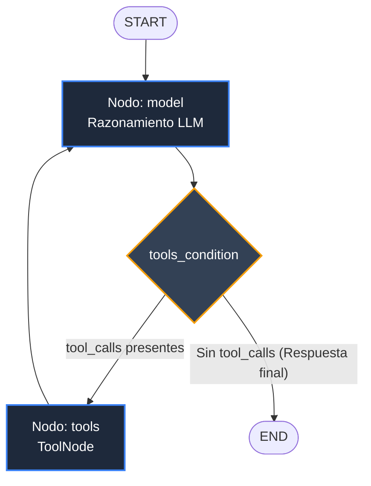

# Pre-entrega 5: Agente de Razonamiento Cíclico con Memoria Persistente

Implementación de un agente autónomo bajo el patrón **ReAct (Reason + Act + Observe)** construido con **LangGraph**, **LangChain** y **Python 3.12+**, con persistencia local respaldada por **SqliteSaver** / **AsyncSqliteSaver**.

---

## 📋 Tabla de Contenidos

1. [Descripción del Proyecto](#descripción-del-proyecto)
2. [Arquitectura del Grafo](#arquitectura-del-grafo)
3. [Ciclo de Razonamiento ReAct](#ciclo-de-razonamiento-react)
4. [Estructura del Repositorio](#estructura-del-repositorio)
5. [Requisitos Previos](#requisitos-previos)
6. [Instalación y Configuración](#instalación-y-configuración)
7. [Ejecución del Agente](#ejecución-del-agente)
8. [Ejecución de Pruebas Unitarias](#ejecución-de-pruebas-unitarias)
9. [Evidencia de Trazas de Ejecución](#evidencia-de-trazas-de-ejecución)
10. [Decisiones de Diseño y Criterios de Aceptación](#decisiones-de-diseño-y-criterios-de-aceptación)

---

## 🎯 Descripción del Proyecto

El agente resuelve consultas comerciales y logísticas complejas de manera autónoma. A diferencia de cadenas DAG lineales rígidas, este sistema cuenta con:

- **Autonomía:** El modelo de lenguaje decide cuándo y con qué parámetros llamar a una o más herramientas externas basándose exclusivamente en el prompt y los esquemas/docstrings de las herramientas (sin ramificaciones manuales `if/else`).
- **Razonamiento Multi-Paso:** Ante consultas complejas, el agente encadena múltiples invocaciones de herramientas (≥2 llamadas) antes de sintetizar una respuesta definitiva.
- **Ciclo de Retorno y Tolerancia a Fallos:** Si una consulta es ambigua o una herramienta devuelve un error o datos vacíos, el modelo reacciona, analiza el resultado y pide aclaraciones o intenta una ruta alternativa.
- **Persistencia de Sesión (`thread_id`):** Almacena el historial y los estados de ejecución en una base de datos local SQLite (`checkpoints.db`) mediante `AsyncSqliteSaver`, permitiendo continuar la conversación en turnos posteriores recordando todo el contexto previo.
- **Control de Recursión:** Cada invocación asíncrona está acotada por `recursion_limit=10` para prevenir bucles infinitos y costos inesperados.

---

## 🏗 Arquitectura del Grafo

El flujo está construido con `StateGraph(AgentState)` donde `AgentState` hereda formalmente de `MessagesState`:



### Componentes Clave:
1. **Estado (`AgentState`):** Hereda de `MessagesState`. Utiliza el reducer `add_messages` de LangGraph (`Annotated[list[BaseMessage], add_messages]`), asegurando que cada nodo agregue mensajes al historial sin sobrescribir los anteriores.
2. **Nodo `model`:** Invoca a `ChatOpenAI` con herramientas vinculadas mediante `.bind_tools(TOOLS)` y gestión 100% asíncrona (`.ainvoke()`).
3. **Arista condicional `tools_condition`:** Inspecciona el último mensaje emitido por el modelo. Si contiene llamadas a herramientas (`tool_calls`), enruta al nodo `tools`; si contiene solo texto, enruta al nodo `END`.
4. **Nodo `tools` (`ToolNode`):** Ejecuta de forma segura las funciones correspondientes a los `tool_calls` solicitados y emite objetos `ToolMessage`.
5. **Arista de Retorno (`tools -> model`):** Cierra el ciclo ReAct: el LLM observa la salida de la herramienta y decide si necesita otra herramienta o si ya puede responder al usuario.

---

## 🔄 Ciclo de Razonamiento ReAct

El ciclo implementado responde al paradigma **Reason -> Act -> Observe**:

1. **Reason (Pensar):** El LLM recibe la consulta del usuario y el historial. Determina que necesita datos de la base de ventas.
2. **Act (Actuar):** Emite un `tool_call` estructurado (ej. `buscar_pedidos(cliente_id=102)`).
3. **Observe (Observar):** El nodo de herramientas ejecuta la función validada por Pydantic y devuelve un JSON al estado.
4. **Reason (Segundo Paso):** Si faltan datos (ej. el detalle de los productos del último pedido `P-9277`), el agente emite una segunda llamada: `obtener_detalle_pedido(pedido_id="P-9277")`.
5. **Final Response:** Con todos los datos reunidos, el agente elabora la respuesta en lenguaje natural para el usuario.

---

## 📁 Estructura del Repositorio

```
.
├── agent.py            # Grafo LangGraph: AgentState(MessagesState), nodos, tools_condition y persistencia
├── tools.py            # Herramientas @tool con validación Pydantic (buscar_pedidos, obtener_detalle_pedido)
├── main.py             # Script de ejecución async: demo multi-paso + persistencia por thread_id + exportación de trazas
├── test_agent.py       # Suite de pruebas unitarias locales (valida herencia, topología, esquemas y tools)
├── requirements.txt    # Dependencias del proyecto (Python 3.12+)
├── .env.example        # Plantilla de variables de entorno (sin secretos)
├── .gitignore          # Exclusión de venv, .env, __pycache__ y checkpoints.db
├── trace_react.json    # Traza completa de la ejecución en formato JSON estructurado
├── trace_react.log     # Traza legible de la ejecución en formato texto plano / log
└── README.md           # Documentación completa del proyecto
```

---

## ⚙️ Requisitos Previos

- **Python 3.12 o superior**
- **Git**
- Clave de API de OpenAI (`OPENAI_API_KEY`)

---

## 🚀 Instalación y Configuración

### 1. Clonar el repositorio
```bash
git clone https://github.com/thomilopez/AI-Engineering---Pre-Entrega-5.git
cd AI-Engineering---Pre-Entrega-5
```

### 2. Crear y activar el entorno virtual
En Windows (PowerShell):
```powershell
python -m venv venv
.\venv\Scripts\Activate.ps1
```

En Linux / macOS:
```bash
python3 -m venv venv
source venv/bin/activate
```

### 3. Instalar dependencias
```bash
pip install --upgrade pip
pip install -r requirements.txt
```

### 4. Configurar variables de entorno
Copia el archivo de ejemplo y edita tu archivo `.env`:
```bash
cp .env.example .env
```
Contenido de `.env`:
```ini
OPENAI_API_KEY=sk-tu-api-key-de-openai-aqui
MODEL_NAME=gpt-4o-mini
```
*(Nota: El archivo `.env` está ignorado en `.gitignore` para proteger tus credenciales).*

---

## ▶️ Ejecución del Agente

Para ejecutar la demostración completa del agente:

```bash
python main.py
```

### Lo que ejecuta `main.py`:
1. **Turno 1 (Multi-Paso):**
   - **Pregunta:** *"¿Cuántos pedidos tuvo el cliente 102, cuál fue el total gastado y cuáles son los productos incluidos en su último pedido?"*
   - **Comportamiento:** El agente invoca primero `buscar_pedidos(cliente_id=102)`, observa que el último pedido es `P-9277`, e invoca en un segundo paso `obtener_detalle_pedido(pedido_id='P-9277')` para obtener los productos.
   - **Respuesta:** Detalla la cantidad de pedidos (3), total ($14.500) y los productos del servidor Dell y rieles.
2. **Turno 2 (Persistencia por `thread_id`):**
   - **Pregunta:** *"¿Y a qué dirección fue entregado ese último pedido?"*
   - **Comportamiento:** Con el mismo `thread_id="sesion-auditoria-cliente-102"`, el agente lee el estado previo guardado en `checkpoints.db` y responde de inmediato con la dirección de entrega sin volver a consultar la base de datos ni requerir que el usuario repita identificadores.
3. **Generación de Trazas:**
   - Exporta la sesión a [trace_react.json](trace_react.json) y [trace_react.log](trace_react.log).

---

## 🧪 Ejecución de Pruebas Unitarias

El proyecto incluye una suite de pruebas con `unittest` que valida la estructura sin gastar tokens de API:

```bash
python test_agent.py
```

Pruebas validadas:
- Herencia de `AgentState` respecto a `MessagesState`.
- Respuestas válidas de `buscar_pedidos` y manejo de clientes inexistentes.
- Respuestas válidas de `obtener_detalle_pedido`.
- Validación estricta con Pydantic ante parámetros inválidos.
- Verificación de topología de nodos (`model`, `tools`) en el `StateGraph` compilado.
- Disponibilidad de herramientas decoradas con `@tool`.

---

## 📊 Evidencia de Trazas de Ejecución

A continuación se muestra un extracto de la traza generada (disponible completa en `trace_react.log` y `trace_react.json`):

```
===========================================================================
TURNO 1: RAZONAMIENTO Y EJECUCIÓN DEL AGENTE
===========================================================================
Usuario: "¿Cuántos pedidos tuvo el cliente 102, cuál fue el total gastado y cuáles son los productos incluidos en su último pedido?"

  [REASONING] El agente analiza la petición y decide invocar la herramienta: buscar_pedidos
  [ACTION]    Llamada con argumentos: {"cliente_id": 102}
  [OBSERVE]   Resultado devuelto por 'buscar_pedidos':
              {"cliente_id": 102, "nombre_cliente": "TechCorp Argentina", "cantidad_pedidos": 3, "monto_total": 14500.0, "pedidos": [{"pedido_id": "P-9001", "fecha": "2026-03-02", "total": 4200.0}, {"pedido_id": "P-9144", "fecha": "2026-05-19", "total": 5300.0}, {"pedido_id": "P-9277", "fecha": "2026-09-01", "total": 5000.0}]}
  [REASONING] El agente observa que el último pedido es P-9277 pero aún no tiene los productos. Decide invocar: obtener_detalle_pedido
  [ACTION]    Llamada con argumentos: {"pedido_id": "P-9277"}
  [OBSERVE]   Resultado devuelto por 'obtener_detalle_pedido':
              {"pedido_id": "P-9277", "cliente_id": 102, "fecha": "2026-09-01", "total": 5000.0, "items": ["Servidor Rack Dell PowerEdge R750 (1U)", "Kit de rieles deslizantes"], "direccion_entrega": "Datacenter Central, Parque Patricios, CABA", "estado": "Entregado"}
  [RESPONSE]  Respuesta Final del Agente:
              "El cliente 102 (TechCorp Argentina) realizó un total de 3 pedidos por un monto acumulado de $14.500,00. Su último pedido fue el P-9277 (con fecha 2026-09-01 por $5.000,00) y contiene los siguientes productos:
              - Servidor Rack Dell PowerEdge R750 (1U)
              - Kit de rieles deslizantes"
---------------------------------------------------------------------------

===========================================================================
TURNO 2: PERSISTENCIA Y MEMORIA POR THREAD_ID (checkpoints.db)
===========================================================================
Usuario: "¿Y a qué dirección fue entregado ese último pedido?"

  [REASONING] El agente recupera el historial del hilo 'sesion-auditoria-cliente-102'. No necesita volver a consultar la base de datos porque el detalle del pedido P-9277 ya se encuentra en el estado persistido.
  [RESPONSE]  Respuesta Final del Agente:
              "Ese último pedido (P-9277) fue entregado en Datacenter Central, Parque Patricios, CABA (estado: Entregado)."
---------------------------------------------------------------------------
```

---

## 🏆 Decisiones de Diseño y Criterios de Aceptación

| Criterio de la Rúbrica | Implementación en este Repositorio | Archivo / Referencia |
|---|---|---|
| **Autonomía** | Vinculación con `llm.bind_tools(TOOLS)` y enrutamiento con `tools_condition`. El LLM decide autónomamente cuándo llamar a las herramientas sin ningún `if/else` manual. | `agent.py` |
| **Razonamiento Multi-paso** | Consulta que exige encadenar `buscar_pedidos` y luego `obtener_detalle_pedido` (≥2 llamadas en el mismo turno). | `main.py` |
| **Persistencia de Estado** | Configuración de `AsyncSqliteSaver` / `SqliteSaver` indexada por `thread_id`. Permite recordar interacciones pasadas en el Turno 2. | `agent.py`, `main.py` |
| **Resiliencia & Anti-Loop** | Parámetro explícito `recursion_limit=10` en todas las llamadas `.ainvoke()`. | `agent.py`, `main.py` |
| **Validación de Contratos** | Modelos `BaseModel` de Pydantic (`BuscarPedidosInput`, `DetallePedidoInput`) con tipos y restricciones. | `tools.py` |
| **Asincronía (Python 3.12)** | Arquitectura no bloqueante con `asyncio.run()`, `async with`, y llamadas `.ainvoke()`. | `main.py`, `agent.py` |
| **Seguridad de Secretos** | API Keys gestionadas con `python-dotenv` y `.env` excluido del control de versiones. | `.gitignore`, `.env.example` |

